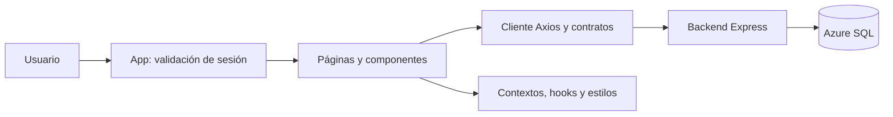

# HostFlow · Frontend

**Una vista centralizada de la operación de alquileres temporarios.**

Interfaz de HostFlow para administrar alojamientos, huéspedes, reservas y tareas de gestión. Combina información operativa, acuerdos monetarios explícitos y recomendaciones de FlowIA en una experiencia responsive con identidad visual propia.

[Backend y API](https://github.com/GogenolaKepa/HostFlow-backend) · [Guía monetaria](docs/monedas-y-cotizaciones.md) · [Panel FlowIA](docs/flowia-panel-lateral.md)

> **Estado actual:** frontend y backend ejecutados localmente, con Azure SQL como base real a través de la API. No se presenta como un SaaS público desplegado en producción. Los canales Booking/Airbnb incluyen simulaciones; registro público y recuperación por correo/WhatsApp todavía no están operativos.

## Contenido

- [Experiencia y módulos](#experiencia-y-módulos)
- [Arquitectura y stack](#arquitectura-y-stack)
- [Instalación y ejecución](#instalación-y-ejecución)
- [API y sesión](#api-y-sesión)
- [Monedas y FlowIA](#monedas-y-flowia)
- [Calidad visual y accesibilidad](#calidad-visual-y-accesibilidad)
- [Pruebas y desarrollo](#pruebas-y-desarrollo)
- [Estado y documentación](#estado-y-documentación)

## Experiencia y módulos

| Módulo | Qué permite consultar o gestionar |
| --- | --- |
| Inicio | Métricas de propiedades, reservas y huéspedes, ocupación y acceso a pendientes operativos. |
| Propiedades | Listado, detalle, edición, imágenes, capacidad, estado y tarifas; herramientas de canales simulados según permisos. |
| Huéspedes | Alta manual, búsqueda, edición y consulta de reservas asociadas. |
| Reservas | Listado y tarjetas, filtros, detalle e historial, alta manual, edición y cancelación lógica con controles de concurrencia. |
| Calendario | Disponibilidad, estadías y conflictos en una vista temporal por propiedad. |
| Limpiezas | Tareas, ventanas operativas, filtros y cambios de estado autorizados. |
| Alertas | Avisos registrados, severidad, filtros y navegación al origen. Sincronizar es una acción separada de consultar. |
| Reportes | KPI, gráficos temporales/de distribución/comparación, filtros y exportaciones, incluidos acuerdos por moneda en CSV. |
| Configuración | Apariencia, preferencias, datos de empresa, horarios y Monedas y cotizaciones. |
| Usuarios y Mi cuenta | Administración según rol, perfil y cambio de contraseña; las acciones disponibles dependen del backend. |
| Notificaciones | Avisos y preferencias; funciones personales sujetas a activación y preparación específica. |
| FlowIA | Análisis operativo local y potenciación externa opcional desde un panel integrado. |

Las acciones de creación, edición, cancelación, sincronización y finalización pueden escribir en la base real. Que una pantalla cargue o una sección monetaria esté en solo lectura no hace de toda la aplicación un entorno de pruebas.

## Arquitectura y stack

**React 19 · Vite 8 · JavaScript/JSX · CSS · Axios · React Router DOM · jsPDF/AutoTable · Oxlint**



El navegador no conecta directamente con Azure SQL ni contiene sus credenciales. La consulta a proveedores externos de IA/cotizaciones se implementa en el backend; la UI solicita esas operaciones de forma explícita.

| Ruta | Responsabilidad |
| --- | --- |
| `src/App.jsx` | Validación/restauración de sesión, errores y entrada a la aplicación. |
| `src/pages/` | Páginas de negocio, login y panel FlowIA. |
| `src/components/` | Controles reutilizables, skeletons, gráficos, monedas y paneles por dominio. |
| `src/context/` | Permisos y estado compartido, incluido el estado monetario. |
| `src/hooks/` | Carga, presencia de overlays, protección de borradores y fondo de login. |
| `src/services/` | Cliente HTTP, sesión, validación de contratos, cálculos y exportaciones. |
| `src/styles/`, `src/App.css` | Tokens y estilos generales/específicos de la interfaz. |
| `src/assets/login/` | Versiones web optimizadas de la fotografía del Login Premium. |
| `tests/`, `docs/` | Pruebas aisladas y documentación técnica por entrega. |

Las restricciones por rol de la interfaz mejoran la experiencia; la autorización y proyección de datos se resuelven también en el servidor. Ocultar un botón no sustituye un permiso de API.

## Instalación y ejecución

### Requisitos

- Git y npm.
- Node compatible con Vite instalado: `^20.19.0` o `>=22.12.0`. Para un entorno común con las pruebas de navegador, usar **Node 22.12 o superior** compatible con las dependencias.
- Backend configurado y autorizado para el entorno que se vaya a utilizar. No se incluyen cuentas ni contraseñas de acceso.

```bash
git clone https://github.com/GogenolaKepa/HostFlow-frontend.git
cd HostFlow-frontend
npm ci
```

### Desarrollo local

Con el backend disponible en el puerto 4000, desde la carpeta frontend, en Git Bash:

```bash
VITE_API_URL=http://127.0.0.1:4000/api npm run dev -- --host 127.0.0.1 --port 5173 --strictPort
```

Abrir **http://127.0.0.1:5173/** e iniciar sesión personalmente con una cuenta autorizada. `--strictPort` evita que Vite cambie silenciosamente de puerto si ya existe otra instancia. Detener con **Ctrl+C** en esa terminal.

El [README del backend](https://github.com/GogenolaKepa/HostFlow-backend#instalación-y-ejecución) describe su preparación y `npm run dev:azure`. Ese launcher mantiene cerradas las escrituras monetarias, pero **no bloquea todas las escrituras de reservas u otros módulos**. No iniciar pruebas funcionales sobre datos reales sin autorización.

### Build y vista previa

```bash
npm run build
npm run preview -- --host 127.0.0.1 --port 4173 --strictPort
```

El build genera `dist/`; `preview` sirve ese resultado localmente y no sustituye un despliegue de producción. `VITE_API_URL` debe estar configurada **antes de generar el build** si se necesita otro destino. No incorporar secretos a variables `VITE_*`: forman parte del cliente distribuido.

## API y sesión

El cliente compartido está en [src/services/api.js](src/services/api.js):

- Usa `VITE_API_URL` cuando está definida.
- En ausencia de esa variable, toma protocolo/hostname del navegador y el puerto `4000`, con base `/api`.
- Gestiona autenticación y fallos de sesión mediante [session.js](src/services/session.js).

El login utiliza los endpoints existentes del backend. Al restaurar una sesión se consulta `/auth/me`; no se muestra el contenido privado mientras se valida. La vista de espera muestra la marca y una línea de actividad indeterminada, sin porcentajes inventados ni demoras artificiales. Los errores reales de autenticación/conexión conservan su tratamiento.

El Login Premium carga una fotografía decorativa optimizada para escritorio/móvil. El formulario está disponible sin esperar la imagen; error de carga o espera superior a 2,5 segundos conserva el degradado como fallback, sin alterar autenticación ni desplazar el formulario.

**Límite conocido:** la sesión utiliza `localStorage`, con el riesgo asociado a XSS. La revalidación de servidor no elimina ese riesgo. No guardar contraseñas, claves de proveedor ni credenciales SQL en el cliente.

## Monedas y FlowIA

### Acuerdos y estimaciones diferentes

La UI presenta por separado:

- **Estimación histórica:** valor que puede no tener moneda declarada; no se le atribuye ARS/USD automáticamente.
- **Acuerdo contractual:** importe y moneda originales cuando existen y el rol puede consultarlos.
- **Equivalencia informativa:** cálculo de consulta que no representa otro ingreso ni modifica el acuerdo.

Reportes mantiene ARS y USD separados; los gráficos de composición pueden mostrar cantidades de reservas/acuerdos por moneda, sin sumar valores económicos incompatibles. Un CSV representa los datos y filtros de su consulta, no un sistema contable.

Monedas y cotizaciones organiza referencia actual, tarifa por propiedad, equivalencia y simulación. El simulador de estadía no reemplaza el contrato. Consultar, previsualizar y guardar son operaciones distintas; las acciones bloqueadas por el entorno se identifican visualmente.

BCRA es una referencia estadística. Banco Nación vía MonedAPI es una fuente intermediaria **informativa**, sin guardado ni fijación de check-in en la implementación actual. La fijación contractual tiene reglas y confirmaciones independientes y no se ejecuta automáticamente por simular una equivalencia.

### FlowIA Premium y privacidad

FlowIA muestra directamente el análisis operativo en un panel modal responsive. Abrir, actualizar y reintentar el análisis local envían **`ia=false`**.

**Potenciar FlowIA** presenta un consentimiento compacto antes de cada envío externo. El desplegable «Datos compartidos y privacidad» identifica a **Google Gemini** y explica los campos operativos enviados y que pueden ser identificables. Solo **Confirmar y potenciar** solicita `ia=true`; cancelar o cerrar no inicia una consulta externa.

No hay todavía consentimiento persistente y revocable comprobado por servidor. No se considera que un clic autorice futuras consultas automáticamente. Si el enriquecimiento no se aplica, se mantiene el análisis local disponible; no se inventan resultados externos. Las recomendaciones son informativas y requieren revisión humana.

## Calidad visual y accesibilidad

- Tema oscuro y claro con tokens de color y preferencias de apariencia.
- Skeleton loaders reutilizables, cargas sin demoras artificiales y estados diferenciados de error/vacío.
- Navegación responsive, controles con nombres accesibles, foco visible y manejo de teclado en paneles.
- Soporte de movimiento reducido en animaciones relevantes.
- Tabla de Reservas con columnas y chips centrados; tarjetas a 1100 px o menos, nombres ajustables y acciones sin superposición.
- Información histórica conservada, sin ocultar importes o asumir su moneda para mejorar la apariencia.

Estas medidas no equivalen a una certificación integral WCAG ni a validación en todos los navegadores/dispositivos. Las pruebas visuales aisladas complementan, pero no sustituyen, la aceptación funcional sobre el entorno autorizado.

## Pruebas y desarrollo

Scripts reales de [package.json](package.json):

| Comando | Propósito |
| --- | --- |
| `npm run dev` | Vite de desarrollo. |
| `npm run build` | Bundle de producción. |
| `npm run preview` | Vista previa local de `dist/`. |
| `npm run lint` | Análisis estático con Oxlint. |
| `npm test` | Pruebas Node de servicios, contratos y componentes, según las suites disponibles. |
| `npm run test:session` | Pruebas focalizadas de sesión. |
| `npm run test:browser` | Harness de navegador con API simulada. |

El harness de navegador utiliza un perfil aislado, Vite efímero sin `.env`, respuestas ficticias y bloqueo de destinos externos no admitidos. No necesita el backend operativo ni Azure y cierra sus procesos temporales al terminar. Por defecto busca Edge en Windows; `HOSTFLOW_TEST_BROWSER` permite indicar la ruta de un ejecutable Chromium compatible ya instalado. Si no encuentra el ejecutable, la suite puede omitirse: comprobar el resultado antes de declararla aprobada.

Ejemplo de ejecución focalizada del listado, en Git Bash:

```bash
HOSTFLOW_TEST_ESTADOS_ONLY=1 npm run test:browser
```

Hay coberturas específicas de carga, sesión, permisos, borradores, contratos, monedas, reportes, exportación y responsive. No se incluyen badges de cobertura o CI ni conteos de pruebas como promesa permanente. Ningún comando de esta sección fue ejecutado para redactar el README.

## Estado y documentación

**Implementado:** módulos descritos, presentación monetaria separada, Login/FlowIA Premium y controles visuales de carga/responsive. **Condicionado por entorno:** persistencia monetaria, guardados empresariales y notificaciones personales. **Simulado:** procesos de canales Booking/Airbnb. **Planificado:** registro público, recuperación por correo, canal WhatsApp y aislamiento multiempresa comercial completo.

Documentación especializada conservada:

- [Normalización operativa](docs/normalizacion-operativa.md).
- [Monedas y cotizaciones](docs/monedas-y-cotizaciones.md) y [recorrido de demostración](docs/demo-monedas.md).
- [Configuración empresarial](docs/configuracion-empresa.md) y [apariencia](docs/configuracion-apariencia.md).
- [Notificaciones y preferencias](docs/notificaciones-y-preferencias.md).
- [Panel FlowIA](docs/flowia-panel-lateral.md).
- [Activación local de cuentas](docs/activacion-local-cuentas.md).
- [Regresión integral](docs/regresion-integral-octubre.md) y [pulido visual](docs/pulido-visual-seguridad.md).

Los documentos fechados conservan evidencia de su entrega; pueden describir estados anteriores de activación o diseño. Para cambios, mantener contratos y permisos, utilizar fixtures ficticios y separar validación aislada de operaciones reales. No modificar datos operativos para obtener una captura o completar una demostración.
